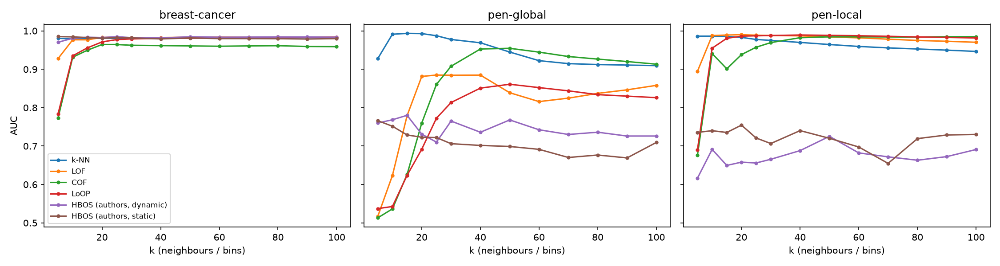

# Assignment 2: Paper Summarization — Data Preparation

## HBOS experiment reproduction

Python reproduction of the main ROC-AUC experiment in Goldstein and Dengel (2012),
*Histogram-based Outlier Score (HBOS): A fast Unsupervised Anomaly Detection Algorithm*.

**Author:** Satyam Kumar · **Course:** INFOMDW Data Wrangling, Utrecht University

This repository contains the numeric HBOS port, comparison detectors, benchmark data,
tests and recorded results. The report and highlighted source paper are available in [`report/`](report/).
This is a partial reproduction: Fast-LOF, INFLO and LDCOF are omitted; the timing
comparison uses a k-means proxy for LDCOF. Best-setting AUCs are explicitly label-tuned
oracles. The paper's complete parameter-selection procedure is unknown.

## Quick start

Use Python 3.12. From this repository folder, in PowerShell:

```powershell
py -3.12 -m venv .venv
.venv\Scripts\python.exe -m pip install -r requirements-review-lock.txt
.venv\Scripts\python.exe -m unittest discover -s tests
.venv\Scripts\python.exe run_table1.py
.venv\Scripts\python.exe explore_hbos_gap.py
```

On macOS/Linux, create the environment with `python3.12 -m venv .venv`, then use
`.venv/bin/python` in place of `.venv\Scripts\python.exe`.
`requirements.txt` gives compatible version ranges; `requirements-review-lock.txt`
records the exact environment used for the code review. Platform-specific dependencies
may require the range-based file on another operating system.

## Experiments

| Command (after environment activation) | Output | Notes |
|---|---|---|
| `python -m unittest discover -s tests` | Unit-test summary | Includes numerical, boundary and input-validation tests |
| `python run_table1.py` | `results/table1_comparison.csv`, `sweep.csv`, `environment.json`; figure | Main AUC experiment; several minutes |
| `python explore_hbos_gap.py` | `results/hbos_gap_tests.csv` | Historical/binning/tie/duplicate diagnostics |
| `python sensitivity_hbos.py` | `results/hbos_sensitivity.csv` | Includes label-tuned per-feature and PyOD searches |
| `python run_loci.py` | `results/loci.csv` | Separate fixed-setting LOCI; pen-global can take about 27 hours |
| `python run_timing.py --repeats 1000` | `results/timing.csv`, `timing_scaling.csv` | Separate timing run; can take about 35 minutes |

Activation, if using the short commands: `.venv\Scripts\Activate.ps1` (PowerShell)
or `source .venv/bin/activate` (macOS/Linux).
Runners overwrite their corresponding output files. Long experiments are manual;
continuous integration runs unit tests only.

## Repository layout

```text
src/          HBOS implementations, detector wrappers and data loader
tests/        Unit and regression tests
data/         Public benchmark files and original dataset description
results/      Recorded CSV results, environment and effective parameters
figures/      AUC-versus-k figure
docs/         Parameters, gap analysis, sources and GitHub instructions
report/       Final report and highlighted source paper
```

## Results and interpretation



The figure compares parameter sensitivity on each dataset; the paper does not identify
its Figure 1 dataset, so this is a Figure 1-style comparison.
See [result definitions and provenance](results/README.md),
[all experiment parameters](docs/parameters.md),
[gap analysis](docs/hbos-gap-analysis.md) and [data/source attribution](docs/resources.md).

Labels are excluded from detector fitting. AUC and oracle selection use labels.
Default and oracle results must remain distinct. Corrections to inherited Java binning
defects are intentional; this port is not an exact Java runtime replication.
Unit tests and source inspection do not prove parity with RapidMiner.

## Paper and attribution

Goldstein, M., and Dengel, A. (2012). *Histogram-based Outlier Score (HBOS):
A fast Unsupervised Anomaly Detection Algorithm*. KI-2012 Poster and Demo Track, 59–63.

- [Paper](https://www.dfki.de/fileadmin/user_upload/import/6431_HBOS-KI-2012.pdf)
- [Authors' Java code](https://github.com/Markus-Go/rapidminer-anomalydetection)
- [Benchmark data](https://doi.org/10.7910/DVN/OPQMVF)

The Java-derived HBOS source retains the upstream AGPL-3.0-or-later terms;
see [NOTICE.md](NOTICE.md) and [LICENSE](LICENSE). Benchmark data retain their CC0 terms.
Third-party libraries retain their respective licenses.

## Submission documents and publication

Follow [the GitHub checklist](docs/github-setup.md). The final report is the only
deliberately missing assignment deliverable in this repository folder.

